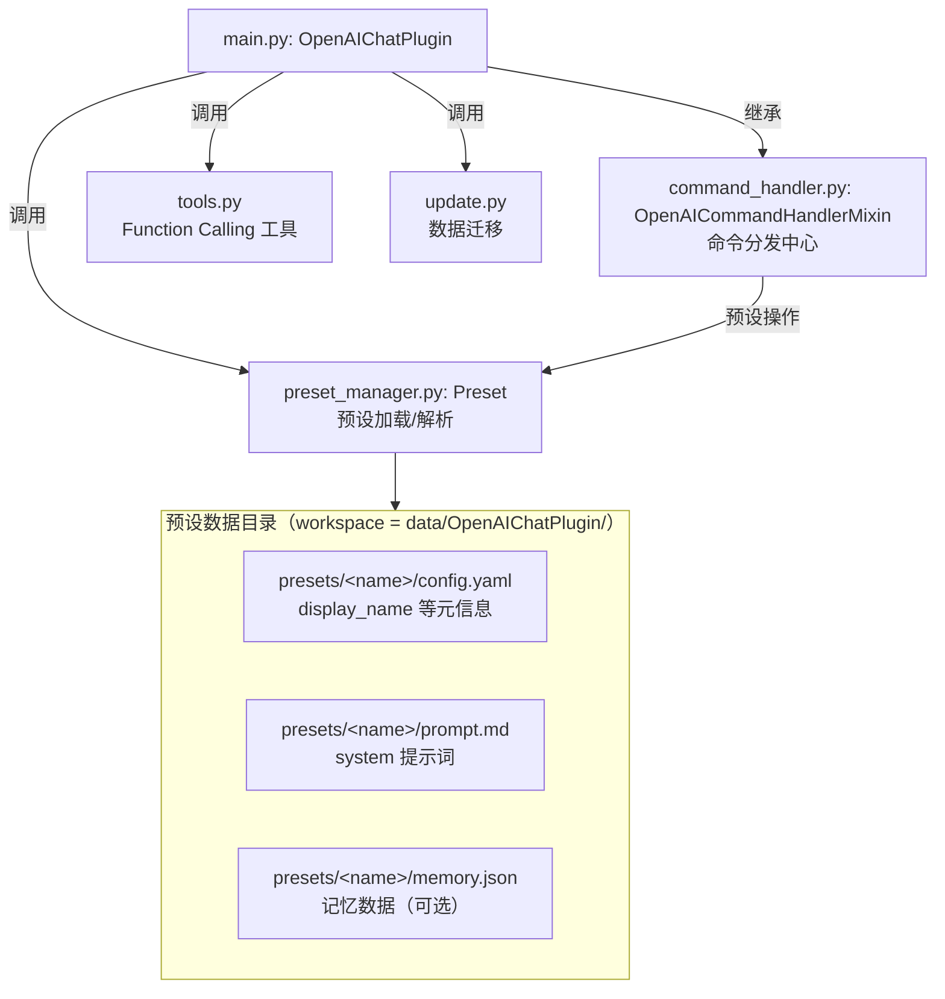
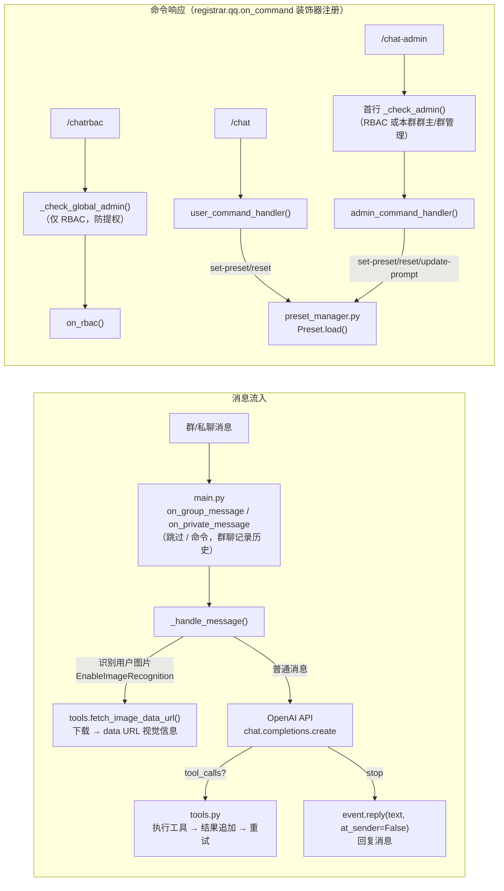
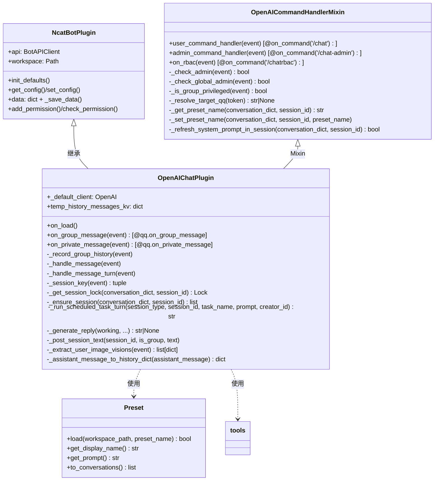

# OpenAIChatPlugin 插件架构与修改指南

## 概述

OpenAI 对话插件（NcatBot 5），通过 OpenAI API 实现智能对话，支持多预设管理、函数调用（Function Calling）、会话持久化、三层权限体系。

本插件为 git 子模块（`v5` 分支）——修改后必须在子模块目录内 `git commit`。

## 文件结构

```
OpenAIChatPlugin/
├── manifest.toml        # 插件清单（name/version/main/entry_class/pip_dependencies）
├── __init__.py          # 导出 OpenAIChatPlugin
├── main.py              # 插件入口：init_defaults、RBAC 注册、消息处理、事件回调
├── command_handler.py   # 命令 Mixin：/chat、/chat-admin、/chatrbac + 三层权限校验
├── preset_manager.py   # 预设管理：Preset 类（config.yaml + prompt.md）
├── reasoning.py         # 思维链剥离（移植自 NcatBotTRPG llm.py）：strip_reasoning / extract_reasoning
├── tools.py             # Function Calling 工具定义与实现（记忆、环境、HTTP 请求、图片视觉、定时任务等）
├── update.py            # 数据迁移：4.x 工作区数据迁移、记忆格式升级
├── exceptions.py        # 自定义异常（TooManyToolCallsException）
├── requirements.txt     # 依赖：openai, pyyaml, beautifulsoup4, markdownify
├── tests/               # pytest 测试（PluginTestHarness + MockAdapter 离线驱动）
└── README.md            # 用户文档
```

## 架构层次



## 数据流



## 类层级关系



MRO: `OpenAIChatPlugin(OpenAICommandHandlerMixin, NcatBotPlugin)`。

## 命令速查

命令通过 `@registrar.qq.on_command('/xxx')` 在 `command_handler.py` 中独立注册（群+私聊均可触发，方法内用 `isinstance(event, GroupMessageEvent)` 判群）：

| 命令 | 权限 | 说明 |
|------|------|------|
| `/chat set-preset <name>` | 所有人 | 设置当前会话预设 |
| `/chat reset` | 所有人 | 重置当前会话 |
| `/chat nolisten [on\|off]` | 所有人 | 群级随机插话开关（on = 关闭；无参查询状态） |
| `/chat help` | 所有人 | 用户帮助 |
| `/chat-admin set-preset <name> [group:\|user:<id>]` | 三层校验 | 跨群/用户设置预设 |
| `/chat-admin reset [group:\|user:<id>]` | 三层校验 | 跨群/用户重置会话 |
| `/chat-admin update-prompt [target\|all]` | 三层校验 | 重载 system 提示词（保留历史） |
| `/chat-admin task list` | **仅全局管理员** | 查看全部定时任务（含状态/失败次数/下次执行） |
| `/chat-admin task delete <name>` | **仅全局管理员** | 删除任意定时任务（可跨会话清理） |
| `/chat-admin task pause` / `resume` | **仅全局管理员** | 暂停/恢复定时任务执行（kill switch） |
| `/chatrbac grant\|revoke\|list <qq>` | **仅全局管理员** | 管理 RBAC 全局管理员 |

## 权限体系（三层）

管理员命令通过 RBAC 权限点 `OpenAIChatPlugin.admin` 管控：

1. **全局管理员**（RBAC，跨群）— `_check_global_admin()` → `self.check_permission(uid, ADMIN_PERMISSION)`
   - `config.yaml` 的 `root`（机器人 owner）在 `on_load()` 自动授权（幂等，随 `data/rbac.json` 持久化）
   - 其余管理员由 root 通过 `/chatrbac grant` 授予、`revoke` 撤销、`list` 查看
2. **群主/群管理自动放行**（本群）— `_is_group_privileged()`
   - `api.qq.query.get_group_member_list` 查 `role in ('owner','admin')`，带 300s TTL 缓存（`_group_role_cache`）
   - 受 `EnableGroupOwnerAutoAuth` 开关控制（默认开）
3. **默认拒绝** — RBAC 服务不可用一律拒绝（fail-closed）

`/chat-admin` 的子命令默认走 `_check_admin()`（RBAC 或本群群管理）；但 `task` 子命令
涉及跨会话/全局资源，额外要求 `_check_global_admin()`。`/chatrbac` 只走 `_check_global_admin()`（严格 RBAC，防群主提权）。

## 配置项

| 键 | 类型 | 默认值 | 说明 |
|----|------|--------|------|
| `ApiKey` | str | `sk-xxxxxxxx...` | OpenAI API Key |
| `Model` | str | `openai/gpt-4o-mini` | 使用的模型 |
| `BaseUrl` | str | `https://api.openai.com/v1` | API 基础 URL |
| `InsertUserdataAsPrefix` | bool | false | 在消息前添加用户名前缀 |
| `MustAtBot` | bool | true | 群聊必须 @ 机器人才能触发 |
| `EnableBuiltinFunctionCalling` | bool | false | 启用内置函数调用 |
| `AllowAccessMemory` | bool | false | 允许 AI 访问记忆（需启用函数调用） |
| `AllowWebRequests` | bool | false | 允许 AI 网络请求（需启用函数调用） |
| `EnableImageRecognition` | bool | true | 识别并下载用户消息中的图片作为视觉输入（无需函数调用） |
| `StripReasoning` | bool | true | 剥离推理模型思维链（标签/DeepSeek 全角分隔符/孤儿闭标签），仅写日志 |
| `EnableRandomReplyGroup` | bool | false | 群聊随机插话总开关（未 @机器人 的消息按概率参与） |
| `GroupRandomReplyChance` | float | 0.02 | 随机插话概率（0~1），命中后仍由模型决定是否发言 |
| `AllowScheduledTasks` | bool | false | 允许 AI 创建/管理定时任务（需启用函数调用） |
| `EnableScheduledTaskExecution` | bool | true | 定时任务执行总开关（kill switch），关闭后不注册/不执行 |
| `MaxRetriesTimes` | int | 15 | 工具调用最大重试次数 |
| `MaxConversationCacheStoreAmount` | int | 1000 | 最大对话缓存存储数量 |
| `IsConfigured` | bool | false | 插件是否已配置 |
| `EnableGroupOwnerAutoAuth` | bool | true | 群主/群管理自动放行本群管理员命令 |

默认值在 `on_load()` 经 `init_defaults()` 注册（仅内存）；可被全局 `config.yaml` 的
`plugin.plugin_configs.OpenAIChatPlugin` 覆盖（高优先级）。写配置用 `self.set_config(key, value)`（立即持久化）。

## 数据持久化

- 会话数据存储在 `self.data['data']`（四个会话子字典：group/user_conversations、group/user_preset_names），
  由 DataMixin 自动持久化到 `<workspace>/data.json`；中途保存用 `self._save_data()`
- 另有 `group_nolisten`（群级随机插话开关，group_id -> bool）与 `scheduled_tasks`
  （AI 定时任务记录，task_name -> {interval, prompt, session_type, session_id, creator_id,
  created_at, failures, disabled, disabled_reason}），
  均由 `on_load()` 幂等 `setdefault` 补齐，无需迁移函数
- v5 事件中 `event.group_id` / `event.user_id` / `event.self_id` 均为 **str**，会话字典键统一为字符串

## 数据迁移（update.py）

- `migrate_legacy_workspace(plugin)`：一次性将旧版 `data/openai_chat_plugin/`（4.x 运行时数据）迁移到新位置
  （旧 `presents/` 整目录复制到新 `presets/` + 旧 json `data` 键迁入 data.json），完成后旧目录改名 `.migrated.bak`；幂等，失败不阻塞加载
- `migrate_presents_dir(plugin)`：将旧工作区中拼写错误的 `presents/` 目录重命名为 `presets/`；幂等，失败不阻塞加载
- `needs_memory_migration` / `migrate_memory_format`：legacy memory.json → v0.1.4+ 格式升级
- 4.x 时代依赖 `config.plugins_config` 的全局配置预设迁移已在 v5 中删除（API 不存在）

## 新增命令指南

1. **帮助文本** — 在 `command_handler.py` 顶部添加 `X_HELP_TEXT` 常量
2. **处理器** — 在 `OpenAICommandHandlerMixin` 中添加 `async def on_xxx(self, event: MessageEvent)`，
   解析参数用 `_parse_command(event)`（shlex 封装，失败自动回复"格式错误"）
3. **权限** — 管理员命令首行 `if not await self._check_admin(event): return`；
   授予/撤销全局权限类命令必须用 `_check_global_admin()`（防提权）
4. **注册** — 方法上加 `@registrar.qq.on_command('/xxx')`，无需在 main.py 额外注册

## 新增预设工具指南

在 `tools.py` 中的 `tools` 列表添加工具定义时：

- 遵循 OpenAI Function Calling 格式（`type: "function"`, `function.name`, `function.description`, `function.parameters`）
- 在 `_handle_message()` 的工具分派 `if-elif` 链中添加对应的调用分支
- 如果工具需要权限控制，添加 `self.get_config('AllowXxx')` 检查并在分派链返回带提示的
  error payload；**不要**再按开关过滤 schema（工具始终对模型可见，关闭时由调用结果告知不可用）
- 需要会话上下文的工具（如投递目标）应由分派链注入 `session_type`/`session_id`，
  不要放进 schema 让模型自由指定
- 返回 JSON 字符串结果（查询类 API 返回 pydantic model 时经 `_to_jsonable()` 转换）

## HTTP 请求与图片视觉

`tools.create_http_request` 是唯一受 `AllowWebRequests` 控制的网络出口，只在
`EnableBuiltinFunctionCalling` 开启时对模型可见：

- `content_format`：`json` / `text` / `markdown` / `image`
- 仅允许 `http/https`，方法白名单 `GET/POST/PUT/PATCH/DELETE/HEAD/OPTIONS`，
  默认超时 15s（上限 60s），文本响应上限 2 MiB、图片上限 5 MiB
- `data` 按 JSON 请求体发送；`headers` / `params` 可选；所有异常与非法参数
  都转为 `status: error` payload，不会向上抛异常中断对话
- `image` 模式返回 `_generate_vision_tool_payload()` 的 data URL；`main.py`
  用 `extract_vision_payload()` 识别后：
  1. 工具历史只写入 `_vision_summary_payload()`（不含 base64）
  2. 等本轮所有 tool 消息追加完，再追加一条带 `image_url` 的 user 视觉消息
- 测试用 `httpx.MockTransport` 注入：单测直接传 `transport=`，
  插件链路测试 monkeypatch `tools._default_http_transport`；禁止真实网络请求

## 用户图片识别（视觉输入）

`EnableImageRecognition`（默认 true）开启时，`_handle_message()` 在处理用户消息前
调用 `_extract_user_image_visions(event)` 识别用户发送的图片：

- 遍历 `event.message.filter_image()`，取每个图片段的 `url`（优先）或 `file` 作为来源
- 经 `tools.fetch_image_data_url(source)` 下载并校验：
  - 来源可为 http/https URL 或本地文件路径；本地文件直接读字节
  - 按文件头**魔数**推断 MIME（`_sniff_image_mime`），支持 PNG / JPEG / GIF / WEBP / BMP；
    不依赖扩展名 / Content-Type，非受支持格式返回 None
  - 流式读取，超过 5 MiB（`MAX_IMAGE_RESPONSE_BYTES`）中止；任何异常均返回 None，不向上抛
- 返回的视觉信息用于把用户消息内容从纯文本字符串升级为 **OpenAI 多模态 list**
  （`[{'type':'text',...}, {'type':'image_url','image_url':{'url':data_url}}, ...]`），
  多张图片全部附加；仅发图片无文字时文本部分补默认说明
- 文本部分取 `event.message.text`（纯文字，避免把 `[CQ:image,...]` 段标记交给模型）
- 识别关闭或图片下载失败时，用户消息保持纯文本字符串，行为与旧版一致
- 测试见 `tests/test_image_vision.py`（`fetch_image_data_url`/`_sniff_image_mime` 单测
  用 `httpx.MockTransport`，对话链路用 `FakeOpenAIClient` + monkeypatch
  `tools._default_http_transport`），覆盖私聊/群聊 @、多图、关闭、下载失败降级

## 思维链剥离（reasoning.py）

移植自 NcatBotTRPG `llm.py`（同作者、同为 AGPL-3.0，文件头已标注来源）。

- `strip_reasoning(text)`：移除 `<think>/<thinking>/<reasoning>/<thought>/<analysis>` 成对标签、
  未闭合开标签（连同其后内容）、DeepSeek-R1 全角分隔符、孤儿闭标签（其前的思维链残留）
- `extract_reasoning(text)`：提取思维链文本，仅供日志
- `main._clean_content()` 统一走 `strip()` +（`StripReasoning` 开启时）`strip_reasoning()`
- 三处剥离点（缺一不可）：
  1. 最终回复 `reply_message`
  2. 工具轮中间正文 `thinking_content`
  3. `_assistant_message_to_history_dict()` 写入历史的 assistant content
- `_log_reasoning()` 把思维链 / `reasoning_content` 以 `AI思维链:` 写日志（截断到
  `OMITTED_TEXT_LENGTH`）；正文为空且无 tool_calls 时按"只有思维链"/"完全没内容"分别告警
- 仅返回思维链时发送环节保持沉默（不追加 assistant 历史，不加兜底文案）

## 群聊随机插话

`EnableRandomReplyGroup`（默认关）+ `GroupRandomReplyChance`（默认 0.02）：

- `on_group_message` → `_handle_message`：未被 @ 时调用 `_should_random_reply(event)`；
  命中后视为必须处理（绕过 `MustAtBot`），并在日志标注"随机插话"
- `_should_random_reply` 依次检查：总开关 → 群级 `group_nolisten` → 概率（clamp 0~1）→
  消息有效性（纯文本或带图）→ 同群 `RANDOM_REPLY_COOLDOWN_SECONDS`（30s）冷却
- 自消息过滤：`str(event.user_id) == str(event.self_id)` 直接跳过，避免自问自答
- `_build_request_messages()` 生成**请求副本**并在**本次用户消息之前**插入
  `RANDOM_REPLY_SYSTEM_PROMPT`（不写回会话历史）；该条固定用 user 角色，
  避免第二条 system 被严格网关（AMD Radeon、GLM 等）400 拒绝。放在末尾而非
  system 之后，是为了让提示贴近最新消息并复用历史前缀缓存
- 随机插话轮 `use_tools=False`（不暴露工具，`tool_choice='none'`）
- 请求限流（429）由 SDK 按 `REQUEST_MAX_RETRIES`（4 次，指数退避）自动重试；
  重试耗尽仍 429 时随机插话静默放弃，@/私聊回复「请求过于频繁，请稍后再试」
- `_is_silent_reply()`：空正文或 `NO_REPLY_PATTERN` 命中（容忍反引号/句点/连字符）→ 不发送、
  不写 assistant 历史、`_save_data()` 后返回
- `/chat nolisten on|off`（无参查询）写 `data['data']['group_nolisten'][group_id]`，
  `on` 表示关闭本群随机插话；所有人可用
- 测试见 `tests/test_random_reply.py`

## AI 定时任务（tools.manage_cron_tasks）

受 `EnableBuiltinFunctionCalling` + `AllowScheduledTasks`（默认关）双重控制：

- 工具 schema **始终完整暴露**（`tools.tools`，不按开关过滤），让模型知道能力存在；
  分派链里校验各 `AllowXxx` 开关，关闭时返回带提示的 error payload（如
  "`AllowScheduledTasks` 配置未启用，当前无法管理定时任务…"）
- 目标锁定：schema 只有 `action/task_name/interval/prompt`，`session_type`/`session_id`
  由 `_handle_message_turn` 按当前事件注入，模型无法指定其他群/私聊
- 任务名：`^[A-Za-z0-9_\-]{1,32}$`；框架任务名为 `OpenAIChatPlugin:<task_name>`
  （框架任务名全局唯一、`remove_scheduled_task` 也按名删除，前缀避免误删其他插件任务）
- 最小间隔：`MIN_SCHEDULED_INTERVAL_SECONDS = 60` **写死**（非配置项）。
  `validate_schedule_interval()` 复用框架 `TimeTaskParser` 解析（保证"插件放行 = 框架可注册"），
  interval 任务 `< 60s`、一次性任务距当前 `< 60s` 一律拒绝，每日 `HH:MM` 直接放行；
  框架解析器只支持单一单位（`2h` / `30m`），`2h30m` 这类复合单位由
  `_normalize_schedule_interval()` 累加换算成 `9000s` 后再交给框架；
  校验在 `register_scheduled_task()` 内，**工具创建与启动恢复共用同一道闸**
- 不做会话隔离：`list` 返回所有会话的任务（含 `session_id` / `prompt`，可查看）；
  `add` 的目标由插件注入只能是当前会话；`delete` 会校验记录的
  `session_type` + `session_id` 与请求会话一致，跨会话删除返回 error
- `register_scheduled_task()` 工具创建与启动恢复共用；框架以**返回值**表示成功/失败，
  必须检查，失败不得写入 `data.json`
- 记录落在 `data['data']['scheduled_tasks']`，`on_load()` 末尾 `_restore_scheduled_tasks()`
  重新注册；恢复不受 `AllowScheduledTasks` 影响（开关只限制模型管理权限），
  但 `< 60s` 的旧记录与 `disabled` 记录会被跳过（记录保留）
- 回调 `_cron_task_callback()` 只负责执行开关、失败计数与清理；实际轮次由
  `plugin._run_scheduled_task_turn()` 完成：
  主会话历史 + 内部消息 `[定时任务 <name>] <prompt>` → `_generate_reply()` 完整对话轮次
  （**支持工具调用**：受 `EnableBuiltinFunctionCalling` 与各 `AllowXxx` 开关控制，
  `asyncio.to_thread` 执行请求避免阻塞事件循环）→ `api.qq.post_group_msg/post_private_msg` →
  **投递成功后**才把整轮消息（内部消息、assistant(tool_calls)、tool、最终回复）写入
  主会话历史并 `_save_data()`（失败整轮不落库，不污染上下文）
- 工具调用的中间正文（与 tool_calls 同时返回的 content）同样投递到会话，与普通聊天一致；
  定时轮没有消息事件时，`get_environment_info` 用创建者/会话信息合成结果
- 任务记录包含 `creator_id`（创建时由 `event.user_id` 注入），供定时轮的
  `access_memory` / `get_environment_info` 识别来源；旧记录缺失时按未知处理
- 通用对话轮次 `_generate_reply()` 同时服务普通聊天与定时任务：普通聊天传入主会话列表，
  定时任务传入"历史副本 + 内部消息"，工具轮次只写副本，成功后才提交
- 会话级锁：`_handle_message()` 拆成"外层过滤 + 按会话加锁"再调用
  `_handle_message_turn()`；`_run_scheduled_task_turn()` 使用同一把
  `_session_locks[(conversation_dict, session_id)]`，保证普通聊天与定时轮次串行、
  历史顺序一致
- 失败与停用：记录的 `failures` 连续失败 +1，成功清零；达到
  `MAX_TASK_CONSECUTIVE_FAILURES = 5` 时标记 `disabled` + `disabled_reason`
  并移出调度器（不再按原间隔无限重试）；一次性任务执行后（无论成败）清理记录
- 执行总开关 `EnableScheduledTaskExecution`（默认开）：关闭时不注册/不执行、
  `manage_cron_tasks` 的 add 直接返回 error；运维命令
  `/chat-admin task list|delete|pause|resume` 走 `_check_global_admin()`，
  其中 `delete` 可跨会话清理、`pause` 会移出调度器并持久化开关、`resume` 重新注册
- 定时任务的内部消息与回复**会写入主会话历史**（与普通聊天共用上下文）
- 测试见 `tests/test_cron_tools.py`（工具可见性/增删查/失败分支/投递/恢复/分派拦截/
  最小间隔/跨会话删除/失败自动停用/一次性清理/暂停与恢复/事件循环不被阻塞/
  主会话历史写入与请求复现/失败不污染历史/同会话串行/定时轮工具循环与工具失败回滚）；
  `tests/test_gating.py` 覆盖"未启用函数调用时请求不带 tools/tool_choice"

## 测试要求

- 测试放 `tests/`，用 `ncatbot.testing.PluginTestHarness` + MockAdapter 离线驱动，
  文件使用 `pytestmark = pytest.mark.asyncio`（pytest-asyncio ≥ 1.0 默认严格模式，
  **不能再传 `mode="strict"`**，否则收集阶段直接报错）
- **必须隔离真实数据**：每个用例 `monkeypatch.chdir(tmp_path)`（RBAC `data/rbac.json` 与插件 workspace 均为相对路径）；
  `conftest.py` 已设置 `NCATBOT_CONFIG_PATH` 指向 `tests/ncatbot_test_config.yaml`（root=123456），
  禁止触碰真实 `config.yaml` / `data/`
- **会话预热夹具**：`conftest.py` 含 session 级 `_warm_first_plugin_load`（autouse）。因 pytest 会以
  无 loader 上下文方式提前导入插件包导致首个 harness 会话 handler 注册失效，预热先空载一次加载/卸载；
  新增用例无需关心此细节
- 运行（推荐在插件目录内执行）：`python -m pytest tests -v -o "addopts="`
  （仓库根目录 `.\.venv\Scripts\python -m pytest plugins/OpenAIChatPlugin/tests -o "addopts="` 亦可）
- 对话链路测试须替换 `plugin._default_client` 为 stub（见 `tests/fake_openai.py`），禁止真实网络请求
- 功能用例：`test_reasoning.py` / `test_reasoning_unit.py`（思维链剥离）、
  `test_random_reply.py`（随机插话：命中/沉默/冷却/群开关/提示固定 user 角色）、
  `test_cron_tools.py`（定时任务：可见性/增删查/失败分支/投递/恢复/分派拦截）
- `test_trpg_coordination.py` 会在模块级探测 `plugins/NcatBotTRPG/manifest.toml`，
  插件不存在时整体 skip，而不是加载报错

## 注意事项

- 预设目录结构：`<workspace>/presets/<preset_name>/` 下包含 `config.yaml` 和 `prompt.md`
- `Preset.to_conversations()` 返回 `[]`（空 prompt）或 `[{"role": "system", "content": "..."}]`
- `_handle_message()` 对以 `/` 开头的消息直接跳过，不调用 API
- 回复统一 `at_sender=False`（保留旧版不 @ 发送者的行为）
- 记忆功能需要 `AllowAccessMemory` 配置和 `EnableBuiltinFunctionCalling` 同时开启
- QQ API 一律经 `self.api.qq.*` 访问（如 `post_group_msg(group_id, text=...)`、`query.get_stranger_info(...)`）
- **与 NcatBotTRPG 协调**：`_handle_message()` 在分发前调用 `_is_trpg_session_active()`，若目标会话
  跑团进行中（`self.get_plugin('NcatBotTRPG')` 的 `is_group_session_active` / `is_user_session_active` 为真）
  则跳过对话回复，避免 @机器人 时两个插件重复回复；NcatBotTRPG 不存在时自动跳过该检查（保持独立可用）。
  相关测试见 `tests/test_trpg_coordination.py`
