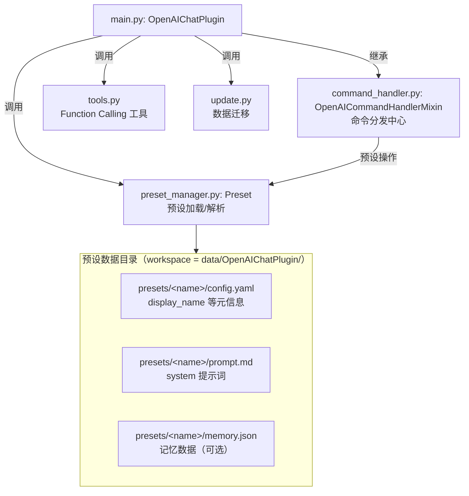
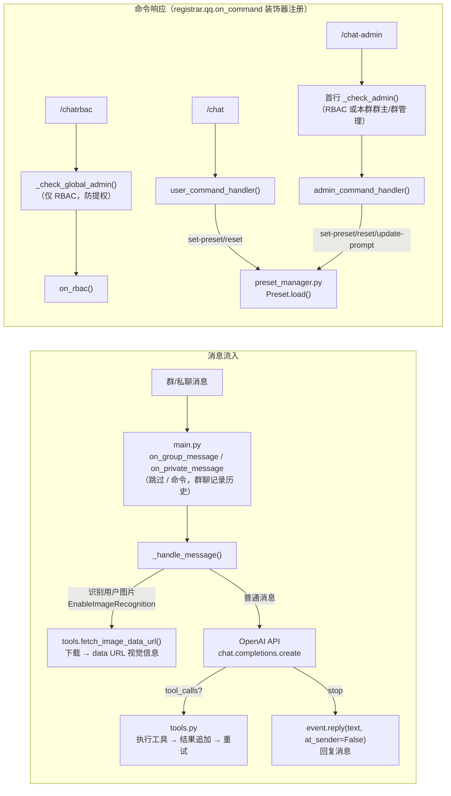
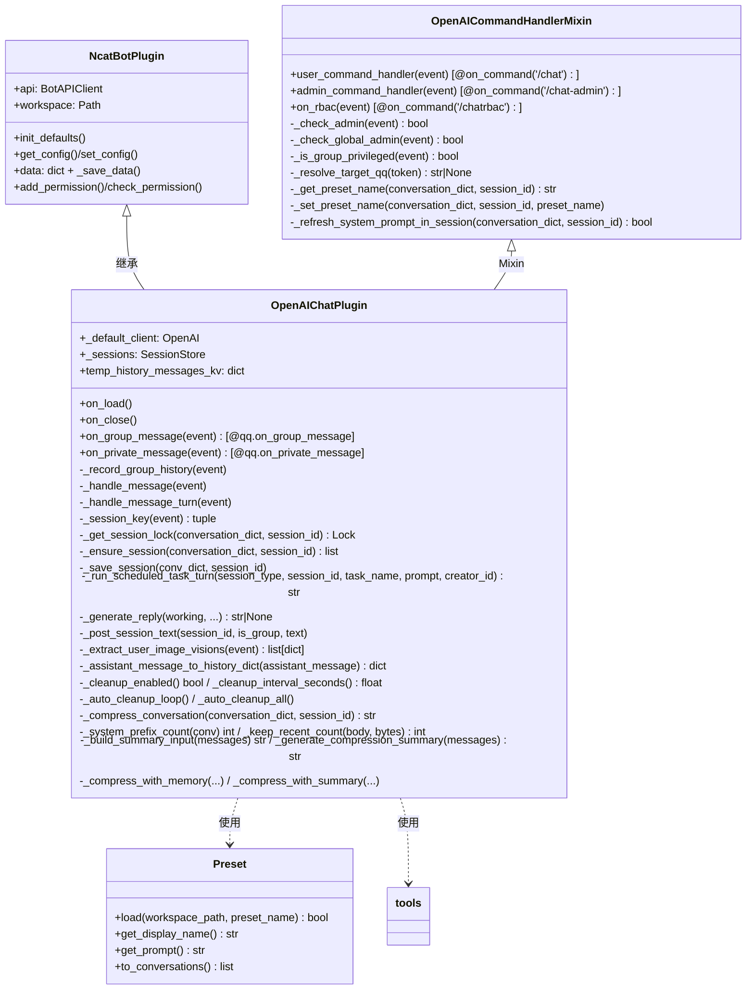

# OpenAIChatPlugin 插件架构与修改指南

## 概述

OpenAI 对话插件（NcatBot 5），通过 OpenAI API 实现智能对话，支持多预设管理、函数调用（Function Calling）、会话持久化、三层权限体系。

本插件为 git 子模块（`v5` 分支）——修改后必须在子模块目录内 `git commit`。

## 文件结构

```
OpenAIChatPlugin/
├── manifest.toml        # 插件清单（name/version/main/entry_class/pip_dependencies）
├── __init__.py          # 导出 OpenAIChatPlugin
├── main.py              # 插件入口：init_defaults、RBAC 注册、消息处理、事件回调、会话压缩
├── prompt.py            # 集中管理硬编码提示词（随机插话提示、视觉说明、定时任务内部消息、压缩系统提示等）
├── command_handler.py   # 命令 Mixin：/chat、/chat-admin、/chatrbac + 三层权限校验
├── preset_manager.py   # 预设管理：Preset 类（config.yaml + prompt.md）
├── session_store.py     # 会话历史分离文件存储（<workspace>/group|user/<id>.json，v0.5.0 起）
├── reasoning.py         # 思维链剥离（移植自 NcatBotTRPG llm.py）：strip_reasoning / extract_reasoning
├── tools.py             # Function Calling 工具定义与实现（记忆、环境、HTTP 请求、图片视觉、定时任务等）
├── update.py            # 数据迁移：4.x 工作区迁移、记忆格式升级、会话拆分迁移
├── exceptions.py        # 自定义异常（TooManyToolCallsException）
├── requirements.txt     # 依赖：openai, pyyaml, beautifulsoup4, markdownify
├── tests/               # pytest 测试（PluginTestHarness + MockAdapter 离线驱动）
└── README.md            # 用户文档
```

## 提示词管理（prompt.py）

`prompt.py` **只放静态文本常量，不写函数**。所有会作为消息内容发给模型的自然语言
提示集中在这里，调整措辞时无需翻 `main.py`；需要格式化或条件拼接的部分
（随机插话提示、定时任务内部消息、压缩请求）在 `main.py` 中组装：

- `RANDOM_REPLY_SYSTEM_PROMPT`：随机插话临时提示（固定 user 角色，不写回会话历史），
  以 `![随机插话提示]` 开头；必须同时包含**正向发言条件**与「拿不准时倾向接一句」的默认，
  只写负向条件会让模型几乎总是回 `NO_REPLY`
- `RANDOM_REPLY_CONTEXT_HEADER`：函数调用不可用时，随机插话提示后面附带
  「群聊最近消息」小节的标题（记录由 `main.py` 从临时缓存截取）
- `IMAGE_ONLY_USER_TEXT`：用户仅发图片、无文字时的兜底文本
- `IMAGE_PLACEHOLDER_TEXT`：模型不支持视觉时，图片在纯文本请求中的占位符（`[图片]`）
- `TOOL_VISION_IMAGE_TEXT`：工具返回图片后附加视觉消息的引导文本
- `SCHEDULED_TASK_MESSAGE_TEMPLATE`：定时任务轮次的内部消息模板
  （`![定时任务 <name>] <prompt>`，`!` 前缀为伪装标记，测试与文档断言须与此一致；
  `main.py` 用 `.format(task_name=..., prompt=...)` 填充）
- `CONVERSATION_COMPRESSION_SYSTEM_PROMPT`：会话压缩生成摘要时的系统提示
- `CONVERSATION_COMPRESSION_USER_TEMPLATE`：压缩请求的用户消息模板
  （`main.py` 用 `.format(history=...)` 填充）

边界：Function Calling 的工具名/描述/参数说明属于工具 schema，仍在 `tools.py`；
用户自定义的 system 提示词来自预设目录的 `prompt.md`，不放进 `prompt.py`。

## 架构层次



## 数据流



## 类层级关系



MRO: `OpenAIChatPlugin(OpenAICommandHandlerMixin, NcatBotPlugin)`。

## 命令速查

命令通过 `@registrar.qq.on_command('/xxx')` 在 `command_handler.py` 中独立注册（群+私聊均可触发，方法内用 `isinstance(event, GroupMessageEvent)` 判群）：

| 命令 | 权限 | 说明 |
|------|------|------|
| `/chat set-preset <name>` | 所有人 | 设置当前会话预设 |
| `/chat reset` | 所有人 | 重置当前会话 |
| `/chat nolisten [on\|off]` | 所有人 | 群级随机插话开关（on = 关闭；无参查询状态） |
| `/chat help` | 所有人 | 用户帮助 |
| `/chat-admin set-preset <name> [group:\|user:<id>]` | 三层校验 | 跨群/用户设置预设 |
| `/chat-admin reset [group:\|user:<id>]` | 三层校验 | 跨群/用户重置会话 |
| `/chat-admin update-prompt [target\|all]` | 三层校验 | 重载 system 提示词（保留历史） |
| `/chat-admin task list` | **仅全局管理员** | 查看全部定时任务（含状态/失败次数/下次执行） |
| `/chat-admin task delete <name>` | **仅全局管理员** | 删除任意定时任务（可跨会话清理） |
| `/chat-admin task pause` / `resume` | **仅全局管理员** | 暂停/恢复定时任务执行（kill switch） |
| `/chatrbac grant\|revoke\|list <qq>` | **仅全局管理员** | 管理 RBAC 全局管理员 |

## 权限体系（三层）

管理员命令通过 RBAC 权限点 `OpenAIChatPlugin.admin` 管控：

1. **全局管理员**（RBAC，跨群）— `_check_global_admin()` → `self.check_permission(uid, ADMIN_PERMISSION)`
   - `config.yaml` 的 `root`（机器人 owner）在 `on_load()` 自动授权（幂等，随 `data/rbac.json` 持久化）
   - 其余管理员由 root 通过 `/chatrbac grant` 授予、`revoke` 撤销、`list` 查看
2. **群主/群管理自动放行**（本群）— `_is_group_privileged()`
   - `api.qq.query.get_group_member_list` 查 `role in ('owner','admin')`，带 300s TTL 缓存（`_group_role_cache`）
   - 受 `EnableGroupOwnerAutoAuth` 开关控制（默认开）
3. **默认拒绝** — RBAC 服务不可用一律拒绝（fail-closed）

`/chat-admin` 的子命令默认走 `_check_admin()`（RBAC 或本群群管理）；但 `task` 子命令
涉及跨会话/全局资源，额外要求 `_check_global_admin()`。`/chatrbac` 只走 `_check_global_admin()`（严格 RBAC，防群主提权）。

## 配置项

| 键 | 类型 | 默认值 | 说明 |
|----|------|--------|------|
| `ApiKey` | str | `sk-xxxxxxxx...` | OpenAI API Key |
| `Model` | str | `openai/gpt-4o-mini` | 使用的模型 |
| `BaseUrl` | str | `https://api.openai.com/v1` | API 基础 URL |
| `InsertUserdataAsPrefix` | bool | false | 在消息前添加用户名前缀 |
| `MustAtBot` | bool | true | 群聊必须 @ 机器人才能触发 |
| `EnableBuiltinFunctionCalling` | bool | false | 启用内置函数调用 |
| `AllowAccessMemory` | bool | false | 允许 AI 访问记忆（需启用函数调用） |
| `AllowWebRequests` | bool | false | 允许 AI 网络请求（需启用函数调用） |
| `AllowLoopbackIps` | bool | false | 允许 HTTP/图片请求访问回环地址（127.0.0.0/8、::1） |
| `AllowLocalNetworkIps` | bool | false | 允许 HTTP/图片请求访问内网地址（10/8、172.16/12、192.168/16、fc00::/7 等） |
| `EnableImageRecognition` | bool | true | 识别并下载用户消息中的图片作为视觉输入（无需函数调用） |
| `StripReasoning` | bool | true | 剥离推理模型思维链（标签/DeepSeek 全角分隔符/孤儿闭标签），仅写日志 |
| `EnableRandomReplyGroup` | bool | false | 群聊随机插话总开关（未 @机器人 的消息按概率参与） |
| `GroupRandomReplyChance` | float | 0.02 | 随机插话概率（0~1），命中后仍由模型决定是否发言 |
| `AllowScheduledTasks` | bool | false | 允许 AI 创建/管理定时任务（需启用函数调用） |
| `EnableScheduledTaskExecution` | bool | true | 定时任务执行总开关（kill switch），关闭后不注册/不执行 |
| `MaxRetriesTimes` | int | 15 | 工具调用最大重试次数 |
| `MaxConversationCacheStoreAmount` | int | 1000 | 最大对话缓存存储数量（也是 `query_missing_message_context` 取回条数的上限） |
| `IsConfigured` | bool | false | 插件是否已配置 |
| `EnableGroupOwnerAutoAuth` | bool | true | 群主/群管理自动放行本群管理员命令 |
| `EnableConversationCompression` | bool | false | 启用会话压缩（超过阈值的历史压缩为摘要）；单独开启即可启动后台压缩循环 |
| `EnableAutoCleanup` | bool | false | 后台压缩循环总开关（与上一项 **OR** 关系，任一开启都会起循环） |
| `AutoCleanupInterval` | int | 1800 | 自动清理**检查**间隔（秒，默认 30 分钟）；仅扫描会话文件 mtime，本身不消耗 API 额度；`<=0`/非法值回退 1800 |
| `AutoCleanupIdleSeconds` | int | 28800 | 会话**闲置多久**才允许自动压缩（秒，默认 8 小时）；活跃会话不会被压缩 |
| `CompressionThresholdBytes` | int | 1048576 | 触发压缩的会话字节数阈值（默认约 350k 中文字符，需按模型上下文调低） |
| `CompressionKeepRecentBytes` | int | 524288 | 压缩时保留的**最近**会话字节数（尾部窗口，system 不计入） |

默认值在 `on_load()` 经 `init_defaults()` 注册（仅内存）；可被全局 `config.yaml` 的
`plugin.plugin_configs.OpenAIChatPlugin` 覆盖（高优先级）。写配置用 `self.set_config(key, value)`（立即持久化）。

## 数据持久化

- **会话消息历史**自 v0.5.0 起由 `SessionStore`（`session_store.py`）按会话独立文件管理：
  `<workspace>/group/<group_id>.json` 与 `<workspace>/user/<user_id>.json`，文件内容为
  纯消息数组（JSON list）。`group_preset_names` / `user_preset_names` 两字典仍留在
  `data.json`（会话维度的小状态，非消息历史）
- `SessionStore` 内存缓存保留 `list` 引用：`load()` 返回的列表原地 `append` /
  `history[:] = working` 即可反映到存储层，随后调用 `save()` 落盘——与旧 data.json
  时代「先改列表、再显式保存」的编写方式一致；`replace()` 内部浅拷贝，**不持有
  调用方列表**，测试断言历史时必须重新 `load()`，不能持有旧引用；`mtime()`
  返回会话文件最后修改时间（自动清理用它做闲置检测）
- `main.py` 的 `_save_session(conv_dict, session_id)` = `_sessions.save()` + `_save_data()`
  （preset_names 仍在 data.json，会话文件变更后两者都要写）
- 其余data.json 键：`group_nolisten`（群级随机插话开关，group_id -> bool）与
  `scheduled_tasks`（AI 定时任务记录，task_name -> {interval, prompt, session_type, session_id,
  creator_id, created_at, failures, disabled, disabled_reason}），
  均由 `on_load()` 幂等 `setdefault` 补齐，无需迁移函数
- v5 事件中 `event.group_id` / `event.user_id` / `event.self_id` 均为 **str**，会话字典键与
  SessionStore 的 session_id 统一为字符串（文件名经消毒：非 `[A-Za-z0-9_-]` 字符替换为 `_`）
- 写入采用「临时文件 + `os.replace`」原子替换，避免半截 JSON；会话级并发由
  `_session_locks` 保证，SessionStore 自身不加锁
- **文件损坏容错**：`SessionStore.load()` 读到坏 JSON 时记错误日志并返回 `None`；
  业务侧必须按「`load() is None` → 用默认预设重建」处理（`_handle_message_turn()` /
  `_ensure_session()` 均如此），**不能**用 `has()` 判断是否存在会话——损坏文件的
  `has()` 为 True 但 `load()` 为 None，会退化成 `AttributeError` 让会话永久不可用
- `group_preset_names` / `user_preset_names` 的键统一 `str(session_id)`（`_get/_set_preset_name`
  内部归一化并清理历史 int 键），否则 `/chat-admin set-preset group:<id>` 写入的 int 键
  与 `_sessions.ids()` 返回的 str 键对不上，`update-prompt all` 会用默认预设覆盖该会话提示词

## 数据迁移（update.py）

- `needs_conversation_split_migration(plugin)` / `migrate_conversations_to_split_files(plugin)`（v0.5.0）：
  一次性把旧版 data.json 集中存储的 `group_conversations` / `user_conversations`
  拆分到 `<workspace>/group|user/<id>.json` 分离文件（int 键归一化为 str 文件名）；
  迁移前备份 `data.json.bak.<unix时间戳>`，**全部会话成功才删除旧键**（部分失败保留旧键，
  下次启动自动重试失败的会话）；目标文件已存在则跳过该会话（幂等，不覆盖新数据）。
  调用点在 `on_load()` 的 `migrate_legacy_workspace` **之后**（4.x 数据先汇入 data.json 再拆分）
- `migrate_legacy_workspace(plugin)`：一次性将旧版 `data/openai_chat_plugin/`（4.x 运行时数据）迁移到新位置
  （旧 `presents/` 整目录复制到新 `presets/` + 旧 json `data` 键迁入 data.json），完成后旧目录改名 `.migrated.bak`；幂等，失败不阻塞加载
- `migrate_presents_dir(plugin)`：将旧工作区中拼写错误的 `presents/` 目录重命名为 `presets/`；幂等，失败不阻塞加载
- `needs_memory_migration` / `migrate_memory_format`：legacy memory.json → v0.1.4+ 格式升级
- 4.x 时代依赖 `config.plugins_config` 的全局配置预设迁移已在 v5 中删除（API 不存在）

## 新增命令指南

1. **帮助文本** — 在 `command_handler.py` 顶部添加 `X_HELP_TEXT` 常量
2. **处理器** — 在 `OpenAICommandHandlerMixin` 中添加 `async def on_xxx(self, event: MessageEvent)`，
   解析参数用 `_parse_command(event)`（shlex 封装，失败自动回复"格式错误"）
3. **权限** — 管理员命令首行 `if not await self._check_admin(event): return`；
   授予/撤销全局权限类命令必须用 `_check_global_admin()`（防提权）
4. **注册** — 方法上加 `@registrar.qq.on_command('/xxx')`，无需在 main.py 额外注册

## 新增预设工具指南

在 `tools.py` 中的 `tools` 列表添加工具定义时：

- 遵循 OpenAI Function Calling 格式（`type: "function"`, `function.name`, `function.description`, `function.parameters`）
- 在 `_handle_message()` 的工具分派 `if-elif` 链中添加对应的调用分支
- 如果工具需要权限控制，添加 `self.get_config('AllowXxx')` 检查并在分派链返回带提示的
  error payload；**不要**再按开关过滤 schema（工具始终对模型可见，关闭时由调用结果告知不可用）
- 需要会话上下文的工具（如投递目标）应由分派链注入 `session_type`/`session_id`，
  不要放进 schema 让模型自由指定
- 返回 JSON 字符串结果（查询类 API 返回 pydantic model 时经 `_to_jsonable()` 转换）

## HTTP 请求与图片视觉

`tools.create_http_request` 是唯一受 `AllowWebRequests` 控制的网络出口，只在
`EnableBuiltinFunctionCalling` 开启时对模型可见：

- `content_format`：`json` / `text` / `markdown` / `image`
- 仅允许 `http/https`，方法白名单 `GET/POST/PUT/PATCH/DELETE/HEAD/OPTIONS`，
  默认超时 15s（上限 60s），文本响应上限 2 MiB、图片上限 5 MiB
- `data` 按 JSON 请求体发送；`headers` / `params` 可选；所有异常与非法参数
  都转为 `status: error` payload，不会向上抛异常中断对话
- **SSRF 防护**：`_check_protected_host()` 在**每一跳请求前**校验目标主机——
  IP 字面量直接判定，域名经 `_dns_resolver()`（默认 `asyncio.getaddrinfo`，
  在线程池执行不阻塞事件循环）解析后对**全部** A/AAAA 记录逐条判定，任一命中
  即拒绝；DNS 解析失败一律拒绝（fail-closed）。拦截规则（`_classify_ip()`）：
  1. 回环（127.0.0.0/8、::1、IPv4-mapped `::ffff:127.0.0.1`）——受 `AllowLoopbackIps` 控制
  2. 内网/私有段（10/8、172.16/12、192.168/16、fc00::/7 等）——受 `AllowLocalNetworkIps` 控制
  3. **一律拦截、无配置项**：链路本地（含云元数据 `169.254.169.254`）、
     未指定（0.0.0.0、::）、组播、保留段、非全局可路由地址（CGNAT 100.64/10 等）
- 重定向**手动逐跳跟随**（`follow_redirects=False` + `MAX_HTTP_REDIRECTS = 5`），
  每一跳重新校验主机与协议（`_resolve_redirect_target()`），防止「公网 URL
  302 到内网地址」绕过；303/302 除 HEAD 外降级为 GET、301 仅 POST 降级、307/308
  保持方法与请求体（均与 httpx 默认一致）；查询参数不带到下一跳；图片来源
  记录最终跳 URL
- 手动跟随重定向后需自行复刻 httpx 的请求头清理（`_redirect_headers()`）：跨源
  移除 `Authorization` / `Proxy-Authorization`（http→https 同主机保留）与 `Host`
  （由 httpx 重建），任何重定向都移除 `Cookie`；方法降级为 GET 时移除
  `Content-Length` / `Transfer-Encoding`。缺失这些清理会把凭据泄露给重定向目标
- 网络层错误文案统一为「请求失败：…」，不区分超时/连接失败/DNS 失败，
  避免被当作端口与路径存在性探测的 oracle（HTTP 状态码与响应片段仍保留）
- 配置由 `main.py` 分派链注入（`allow_loopback_ips` / `allow_local_network_ips`
  参数），模型传入的同名参数一律 `pop` 忽略，不能自行放行
- 已知权衡：采用「请求前解析校验」而非「用解析出的 IP 建连、Host 头保留原域名」
  的 pinning 方案（后者需要自定义 TLS 上下文才能保住 HTTPS 证书校验），
  存在理论上的 DNS rebinding 窗口；对本插件「模型/提示注入驱动」的威胁模型
  足够，重定向绕过已逐 hop 堵死
- `image` 模式返回 `_generate_vision_tool_payload()` 的 data URL；`main.py`
  用 `extract_vision_payload()` 识别后：
  1. 工具历史只写入 `_vision_summary_payload()`（不含 base64）
  2. 等本轮所有 tool 消息追加完，再追加一条带 `image_url` 的 user 视觉消息
- 用户图片识别链路（`tools.fetch_image_data_url` 的 http/https 分支）共用
  同一道 SSRF 闸门与手动重定向逻辑；策略同样由 `main._extract_user_image_visions()`
  按运营配置注入
- 测试用 `httpx.MockTransport` 注入：单测直接传 `transport=`，
  插件链路测试 monkeypatch `tools._default_http_transport`；DNS 解析统一
  monkeypatch `tools._dns_resolver` 为返回公网 IP 的 stub（否则 SSRF 校验
  会发起真实 DNS 请求）；禁止真实网络请求。详见 `tests/test_ssrf.py`

## 用户图片识别（视觉输入）

`EnableImageRecognition`（默认 true）开启时，`_handle_message()` 在处理用户消息前
调用 `_extract_user_image_visions(event)` 识别用户发送的图片：

- 遍历 `event.message.filter_image()`，取每个图片段的 `url`（优先）或 `file` 作为来源
- 经 `tools.fetch_image_data_url(source)` 下载并校验：
  - 来源可为 http/https URL 或本地文件路径；本地文件直接读字节
  - http/https 分支共用 HTTP 工具的 SSRF 闸门（主机校验 + 手动逐跳重定向，
    策略按 `AllowLoopbackIps` / `AllowLocalNetworkIps` 注入），防止伪造的
    图片消息段指向内网/云元数据地址
  - 按文件头**魔数**推断 MIME（`_sniff_image_mime`），支持 PNG / JPEG / GIF / WEBP / BMP；
    不依赖扩展名 / Content-Type，非受支持格式返回 None
  - 流式读取，超过 5 MiB（`MAX_IMAGE_RESPONSE_BYTES`）中止；任何异常均返回 None，不向上抛
- 返回的视觉信息用于把用户消息内容从纯文本字符串升级为 **OpenAI 多模态 list**
  （`[{'type':'text',...}, {'type':'image_url','image_url':{'url':data_url}}, ...]`），
  多张图片全部附加；仅发图片无文字时文本部分补默认说明
- 文本部分取 `event.message.text`（纯文字，避免把 `[CQ:image,...]` 段标记交给模型）
- 识别关闭或图片下载失败时，用户消息保持纯文本字符串，行为与旧版一致
- **纯文本模型自动降级**：历史里已持久化的 `image_url` 会让只接受 `content.type='text'`
  的供应商（如智谱 GLM 返回 400 code 1210）整轮失败。`_generate_reply()` 捕获
  `BadRequestError` 且文案匹配 `content.type` / 不支持的 `image_url` 时，用
  `_text_only_messages()` 把请求副本压平成纯文本（图片 → `[图片]`，**不改会话历史**）
  重试一次，并置 `_vision_unsupported=True`：后续轮次提前压平、跳过用户图片下载、
  工具图片只保留摘要不追加视觉消息。无关的 400 不会被误判
- 测试见 `tests/test_image_vision.py`（`fetch_image_data_url`/`_sniff_image_mime` 单测
  用 `httpx.MockTransport`，对话链路用 `FakeOpenAIClient` + monkeypatch
  `tools._default_http_transport`），覆盖私聊/群聊 @、多图、关闭、下载失败降级；
  `tests/test_text_only_model.py` 覆盖 400 降级、后续请求提前压平与无关 400 不误判

## 思维链剥离（reasoning.py）

移植自 NcatBotTRPG `llm.py`（同作者、同为 AGPL-3.0，文件头已标注来源）。

- `strip_reasoning(text)`：移除 `<think>/<thinking>/<reasoning>/<thought>/<analysis>` 成对标签、
  未闭合开标签（连同其后内容）、DeepSeek-R1 全角分隔符、孤儿闭标签（其前的思维链残留）
- `extract_reasoning(text)`：提取思维链文本，仅供日志
- `main._clean_content()` 统一走 `strip()` +（`StripReasoning` 开启时）`strip_reasoning()`
- 三处剥离点（缺一不可）：
  1. 最终回复 `reply_message`
  2. 工具轮中间正文 `thinking_content`
  3. `_assistant_message_to_history_dict()` 写入历史的 assistant content
- `_log_reasoning()` 把思维链 / `reasoning_content` 以 `AI思维链:` 写日志（截断到
  `OMITTED_TEXT_LENGTH`）；正文为空且无 tool_calls 时按"只有思维链"/"完全没内容"分别告警
- 仅返回思维链时发送环节保持沉默（不追加 assistant 历史，不加兜底文案）

## 群聊随机插话

`EnableRandomReplyGroup`（默认关）+ `GroupRandomReplyChance`（默认 0.02）：

- `on_group_message` → `_handle_message`：未被 @ 时调用 `_should_random_reply(event)`；
  命中后视为必须处理（绕过 `MustAtBot`），并在日志标注"随机插话"
- `_should_random_reply` 依次检查：总开关 → 群级 `group_nolisten` → 概率（clamp 0~1）→
  消息有效性（纯文本或带图）→ 同群 `RANDOM_REPLY_COOLDOWN_SECONDS`（30s）冷却
- 自消息过滤：`str(event.user_id) == str(event.self_id)` 直接跳过，避免自问自答
- `_build_request_messages()` 生成**请求副本**并在**本次用户消息之前**插入
  `RANDOM_REPLY_SYSTEM_PROMPT`（不写回会话历史）；该条固定用 user 角色，
  避免第二条 system 被严格网关（AMD Radeon、GLM 等）400 拒绝。放在末尾而非
  system 之后，是为了让提示贴近最新消息并复用历史前缀缓存
- 插入下标由 `_generate_reply()` 在工具循环**前**固定为本次用户消息的下标
  （`random_hint_at`），不能每轮按 `len-1` 重新推断：工具轮会追加
  assistant/tool 消息，重新推断会把提示插进 `assistant(tool_calls)` 与 `tool`
  之间（严格网关 400，语义也变成「对工具结果的备注」）
- 提示内容由 `main._build_random_reply_hint()` 组装（`prompt.py` 只提供静态文本）：
  - `EnableBuiltinFunctionCalling` 开启：只注入 `RANDOM_REPLY_SYSTEM_PROMPT`，其中鼓励
    模型主动调用 `query_missing_message_context` 查看被忽略的群消息，**不**由插件直接
    附带记录
  - 该工具的 `count` 参数控制取回条数（默认 `DEFAULT_MISSING_CONTEXT_COUNT`=50），
    分派链注入 `max_count=MaxConversationCacheStoreAmount` 作为硬上限，避免一次
    拉回整段缓存撑爆上下文
  - **取回成功后清空该群的 `temp_history_messages_kv` 全部临时消息**（即使只返回
    最近 N 条也算已消费），保留空列表而不是删除 key，后续查询仍是 success + 空数组
  - 函数调用关闭（`query_missing_message_context` 不可调用）：才在提示后追加
    `RANDOM_REPLY_CONTEXT_HEADER` + 最近最多 `RANDOM_REPLY_CONTEXT_MESSAGES`（20）条
    群聊记录（`_recent_group_messages()` 从 `temp_history_messages_kv` 取，排除已在会话
    历史里的文本；单条截断到 `RANDOM_REPLY_CONTEXT_LINE_CHARS`，含 `NO_REPLY` 的发言剔除）
  - 临时缓存由 `_record_group_history()` **始终记录**（纯内存，仍受
    `MaxConversationCacheStoreAmount` 限制），不依赖 `EnableBuiltinFunctionCalling`
- 随机插话轮**保留工具能力**（与普通聊天一致，受 `EnableBuiltinFunctionCalling`
  与各 `AllowXxx` 开关约束）；工具轮写入**工作副本**，发言成功或沉默（`NO_REPLY`）
  时提交回主会话——沉默时工具轮与归一化的沉默决定（`NO_REPLY_SENTINEL`）一并落库，
  哨兵变体与空正文统一记为 `NO_REPLY`；仅异常（限流/工具上限/内部错误）时整轮丢弃，
  避免失败轮次污染上下文
- 随机插话轮的工具中间正文**不投递**到群（避免「先说话再沉默」）；工具轮上限
  （`TooManyToolCallsException`）与内部错误在随机轮同样静默，只写日志
- 提示词同时给出正向发言条件（话题相关/有人提问没人接/适合附和吐槽）与
  「拿不准时倾向简短接一句」的默认，并明确「不要为了决定是否插话而反复查记忆」。
  只保留负向条件（闲聊/没什么可说 → NO_REPLY）会让模型几乎总是沉默
  （实测 20 次命中 19 次不发言）
- 提示词**不描述性格**：人设、语气、称呼全部以用户预设 `prompt.md` 为准，随机提示只
  决定「是否发言」
- 请求限流（429）由 SDK 按 `REQUEST_MAX_RETRIES`（4 次，指数退避）自动重试；
  重试耗尽仍 429 时随机插话静默放弃，@/私聊回复「请求过于频繁，请稍后再试」
- `_is_silent_reply()`：空正文或 `NO_REPLY_PATTERN` 命中（容忍反引号/句点/连字符）→
  不发送，但把工具轮与归一化沉默决定（`NO_REPLY_SENTINEL`）写入主会话后 `_save_session()`
- `/chat nolisten on|off`（无参查询）写 `data['data']['group_nolisten'][group_id]`，
  `on` 表示关闭本群随机插话；所有人可用
- 测试见 `tests/test_random_reply.py`

## AI 定时任务（tools.manage_cron_tasks）

受 `EnableBuiltinFunctionCalling` + `AllowScheduledTasks`（默认关）双重控制：

- 工具 schema **始终完整暴露**（`tools.tools`，不按开关过滤），让模型知道能力存在；
  分派链里校验各 `AllowXxx` 开关，关闭时返回带提示的 error payload（如
  "`AllowScheduledTasks` 配置未启用，当前无法管理定时任务…"）
- 目标锁定：schema 只有 `action/task_name/interval/prompt`，`session_type`/`session_id`
  由 `_handle_message_turn` 按当前事件注入，模型无法指定其他群/私聊
- 任务名：`^[A-Za-z0-9_\-]{1,32}$`；框架任务名为 `OpenAIChatPlugin:<task_name>`
  （框架任务名全局唯一、`remove_scheduled_task` 也按名删除，前缀避免误删其他插件任务）
- 最小间隔：`MIN_SCHEDULED_INTERVAL_SECONDS = 60` **写死**（非配置项）。
  `validate_schedule_interval()` 复用框架 `TimeTaskParser` 解析（保证"插件放行 = 框架可注册"），
  interval 任务 `< 60s`、一次性任务距当前 `< 60s` 一律拒绝，每日 `HH:MM` 直接放行；
  框架解析器只支持单一单位（`2h` / `30m`），`2h30m` 这类复合单位由
  `_normalize_schedule_interval()` 累加换算成 `9000s` 后再交给框架；
  校验在 `register_scheduled_task()` 内，**工具创建与启动恢复共用同一道闸**
- 不做会话隔离：`list` 返回所有会话的任务（含 `session_id` / `prompt`，可查看）；
  `add` 的目标由插件注入只能是当前会话；`delete` 会校验记录的
  `session_type` + `session_id` 与请求会话一致，跨会话删除返回 error
- `register_scheduled_task()` 工具创建与启动恢复共用；框架以**返回值**表示成功/失败，
  必须检查，失败不得写入 `data.json`
- 记录落在 `data['data']['scheduled_tasks']`，`on_load()` 末尾 `_restore_scheduled_tasks()`
  重新注册；恢复不受 `AllowScheduledTasks` 影响（开关只限制模型管理权限），
  但 `< 60s` 的旧记录与 `disabled` 记录会被跳过（记录保留）
- 回调 `_cron_task_callback()` 只负责执行开关、失败计数与清理；实际轮次由
  `plugin._run_scheduled_task_turn()` 完成：
  主会话历史 + 内部消息 `[定时任务 <name>] <prompt>` → `_generate_reply()` 完整对话轮次
  （**支持工具调用**：受 `EnableBuiltinFunctionCalling` 与各 `AllowXxx` 开关控制，
  `asyncio.to_thread` 执行请求避免阻塞事件循环）→ `api.qq.post_group_msg/post_private_msg` →
  **投递成功后**才把整轮消息（内部消息、assistant(tool_calls)、tool、最终回复）写入
  主会话历史并 `_save_data()`（失败整轮不落库，不污染上下文）
- 工具调用的中间正文（与 tool_calls 同时返回的 content）同样投递到会话，与普通聊天一致；
  定时轮没有消息事件时，`get_environment_info` 用创建者/会话信息合成结果
- 任务记录包含 `creator_id`（创建时由 `event.user_id` 注入），供定时轮的
  `access_memory` / `get_environment_info` 识别来源；旧记录缺失时按未知处理
- 通用对话轮次 `_generate_reply()` 同时服务普通聊天与定时任务：普通聊天传入主会话列表，
  定时任务传入"历史副本 + 内部消息"，工具轮次只写副本，成功后才提交
- 会话级锁：`_handle_message()` 拆成"外层过滤 + 按会话加锁"再调用
  `_handle_message_turn()`；`_run_scheduled_task_turn()` 使用同一把
  `_session_locks[(conversation_dict, session_id)]`，保证普通聊天与定时轮次串行、
  历史顺序一致
- 失败与停用：记录的 `failures` 连续失败 +1，成功清零；达到
  `MAX_TASK_CONSECUTIVE_FAILURES = 5` 时标记 `disabled` + `disabled_reason`
  并移出调度器（不再按原间隔无限重试）；一次性任务执行后（无论成败）清理记录
- 执行总开关 `EnableScheduledTaskExecution`（默认开）：关闭时不注册/不执行、
  `manage_cron_tasks` 的 add 直接返回 error；运维命令
  `/chat-admin task list|delete|pause|resume` 走 `_check_global_admin()`，
  其中 `delete` 可跨会话清理、`pause` 会移出调度器并持久化开关、`resume` 重新注册
- 定时任务的内部消息与回复**会写入主会话历史**（与普通聊天共用上下文）
- 测试见 `tests/test_cron_tools.py`（工具可见性/增删查/失败分支/投递/恢复/分派拦截/
  最小间隔/跨会话删除/失败自动停用/一次性清理/暂停与恢复/事件循环不被阻塞/
  主会话历史写入与请求复现/失败不污染历史/同会话串行/定时轮工具循环与工具失败回滚）；
  `tests/test_gating.py` 覆盖"未启用函数调用时请求不带 tools/tool_choice"

## 会话压缩与自动清理

`EnableConversationCompression`（默认关）+ `CompressionThresholdBytes`（默认 1 MB）：
超过阈值的会话历史压缩为摘要，避免长对话撑爆上下文。

**压缩规则（`_compress_conversation`）**

- 返回 `'compressed' | 'skipped' | 'failed'`：未开启 / 无会话文件 / 未达阈值 /
  正文消息数 ≤ 2 / 无可压缩前缀均 `'skipped'`；**摘要生成或记忆写入失败一律 `'failed'`
  且不修改会话历史**
- **`system` 提示词永不参与压缩**：`_system_prefix_count()` 取出会话首条 system，
  压缩只作用于其后的正文，压缩后 system 仍在 `conv[0]`（预设人格不会因压缩丢失）
- **保留窗口是尾部**：`_keep_recent_count()` 从后往前累计 `CompressionKeepRecentBytes`
  字节（至少 1 条），只压缩更早的消息；`messages_to_compress = body[:-keep_count]`，
  删除时按 `del conv[insert_at:insert_at + len(to_compress)]`（**不要写成 `del conv[-N:]`**，
  那是删最新的消息，语义正好相反）
- 压缩直接改内存中的消息列表，之后显式 `_sessions.save()` 落盘分离文件

**两条落点**

- `EnableBuiltinFunctionCalling` + `AllowAccessMemory` 同时开启 → `_compress_with_memory`：
  摘要写入预设 `memory.json`，`from_group`/`from_user` 按会话类型注入，
  **必须用 `_tool_payload_succeeded()` 校验返回 payload**，写入失败就中止并保留历史
- 否则 → `_compress_with_summary`：摘要作为 `[历史摘要] ...` 消息插在 **system 之后**
  （不是会话末尾）

**摘要输入（`_build_summary_input`）**

- 只取文本部分，图片渲染成 `[图片]` 占位，base64 绝不进入摘要
- 超出 `SUMMARY_INPUT_BUDGET_CHARS`（12000 字符）时**等距抽样**并保留末行，保证摘要
  覆盖整段被删历史而不是只截开头；抽样比例写警告日志

**触发与调度**

- 压缩只由后台循环触发。`on_load()` 在 `EnableConversationCompression` 或
  `EnableAutoCleanup` 任一开启时启动 `_auto_cleanup_loop()`（两者 OR，避免"只开压缩却不生效"）
- 任务引用存 `self._cleanup_task`，`on_close()` 中取消（防热重载后孤儿任务重复压缩）；
  `AutoCleanupInterval <= 0 / 非法值` 回退 1800s（`_cleanup_interval_seconds()`），防忙等扫描
- 循环经 `_sessions.ids()` 枚举**包括仅存磁盘、未加载会话**在内的全部会话逐一检查
  （静默，失败只计数记日志）
- **闲置门控**：`_auto_cleanup_all()` 只压缩闲置时间超过 `AutoCleanupIdleSeconds`
  （默认 28800s = 8 小时）的会话——以会话文件 mtime 作为「最后活跃时间」（任何会话变动
  ——对话轮次落库、reset/set-preset、压缩本身——都会写文件，读操作不更新）。
  活跃会话不会被反复压缩消耗 token，也不会在对话进行中被打断；检查节奏默认
  30 分钟一次（`AutoCleanupInterval`）
- 压缩前先获取 `_session_locks` 的会话锁再判断闲置，避免与在途对话/定时轮次竞态：
  在途轮次落库后 mtime 更新，自然跳过
- `_compress_conversation()` 本身不做闲置判断（直接调用 = 手动压缩语义），
  闲置门控只属于自动清理循环

**阈值取舍**

- `CompressionThresholdBytes` 默认 1 MB（≈350k 中文字符），对 128k 上下文模型明显偏大
  （会先撞 `context_length_exceeded` 再触发压缩）。按模型上下文调低阈值，或接受
  抽样日志提示的静默丢失

**测试**

- 见 `tests/test_compression.py`（保留窗口方向、system 保留、摘要位置、记忆写入失败
  保留历史、抽样覆盖、开关语义、间隔回退、`on_close` 取消任务）
- **所有触发压缩的用例必须 stub `plugin._default_client`**
  （`on_load` 创建的是真实 OpenAI 客户端，不 stub 会发真实请求）

## 测试要求

- 测试放 `tests/`，用 `ncatbot.testing.PluginTestHarness` + MockAdapter 离线驱动，
  文件使用 `pytestmark = pytest.mark.asyncio`（pytest-asyncio ≥ 1.0 默认严格模式，
  **不能再传 `mode="strict"`**，否则收集阶段直接报错）
- **必须隔离真实数据**：每个用例 `monkeypatch.chdir(tmp_path)`（RBAC `data/rbac.json` 与插件 workspace 均为相对路径）；
  `conftest.py` 已设置 `NCATBOT_CONFIG_PATH` 指向 `tests/ncatbot_test_config.yaml`（root=123456），
  禁止触碰真实 `config.yaml` / `data/`
- **会话预热夹具**：`conftest.py` 含 session 级 `_warm_first_plugin_load`（autouse）。因 pytest 会以
  无 loader 上下文方式提前导入插件包导致首个 harness 会话 handler 注册失效，预热先空载一次加载/卸载；
  新增用例无需关心此细节
- 运行（推荐在插件目录内执行）：`python -m pytest tests -v -o "addopts="`
  （仓库根目录 `.\.venv\Scripts\python -m pytest plugins/OpenAIChatPlugin/tests -o "addopts="` 亦可）
- 对话链路测试须替换 `plugin._default_client` 为 stub（见 `tests/fake_openai.py`），禁止真实网络请求
- 功能用例：`test_chat.py`（私聊/群聊对话与工具轮、鉴权拦截）、`test_gating.py`
  （@/MustAtBot 门控与未启用函数调用时不带 tools）、`test_commands.py` /
  `test_permission.py`（命令解析与三层权限）、`test_load.py`（加载与配置注册）、
  `test_reasoning.py` / `test_reasoning_unit.py`（思维链剥离）、
  `test_random_reply.py`（随机插话：命中/沉默（完整轮次落库）/冷却/群开关/提示固定 user 角色、
  工具轮提示位置回归、有工具时优先调上下文工具、无工具时附带并去重群聊记录）、
  `test_context_tool.py`（上下文工具：默认条数/指定 count/配置上限 clamp/非法参数/空缓存/分派链注入）、
  `test_cron_tools.py`（定时任务：可见性/增删查/失败分支/投递/恢复/分派拦截）、
  `test_ssrf.py`（SSRF 防护：地址段分类/主机校验/重定向逐跳复核/配置注入与
  模型参数隔离）、`test_image_vision.py` / `test_tools_http.py`（用户图片识别与
  HTTP 工具）、`test_text_only_model.py`（纯文本模型兼容：400 降级重试/后续
  请求提前压平/无关 400 不误判）、`test_compression.py`（会话压缩：阈值触发/
  记忆路径/摘要路径/失败不修改会话/自动清理循环/**保留最近窗口方向/system 保留/
  摘要位置/记忆写入失败保留历史/摘要抽样覆盖/开关与间隔语义/on_close 取消任务**）、
  `test_session_split.py`（分离文件存储 + v0.5.0 拆分迁移/幂等/失败保留旧键/
  **损坏文件重建**）
- `test_trpg_coordination.py` 会在模块级探测 `plugins/NcatBotTRPG/manifest.toml`，
  插件不存在时整体 skip，而不是加载报错
- **沙箱陷阱（重要）**：`monkeypatch.undo()` 会连带撤销 `monkeypatch.chdir()`，
  之后相对路径与 `PluginTestHarness` 会话会落到 **pytest 调用目录**（从仓库根运行时
  即真实 `data/`，造成污染）。需要在会话间恢复部分 patch 时，用独立
  `pytest.MonkeyPatch()` 实例注入故障（只 undo 它），并在会话内先用
  `plugin.workspace.resolve()` 捕获绝对路径再退出 `async with`。真实数据污染后
  可从 `data.json.bak.<时间戳>` 回滚（`data/` 为 gitignored，无 git 兜底）
- patch 目标写插件模块时用 harness 的包名 `OpenAIChatPlugin.xxx`（不存在
  `plugins.OpenAIChatPlugin` 这个导入路径）；patch `asyncio.to_thread` 这类
  经 `import asyncio` 引用的全局函数，直接 patch 模块属性本身

## 注意事项

- 预设目录结构：`<workspace>/presets/<preset_name>/` 下包含 `config.yaml` 和 `prompt.md`
- `Preset.to_conversations()` 返回 `[]`（空 prompt）或 `[{"role": "system", "content": "..."}]`
- `_handle_message()` 对以 `/` 开头的消息直接跳过，不调用 API
- 回复统一 `at_sender=False`（保留旧版不 @ 发送者的行为）
- 记忆功能需要 `AllowAccessMemory` 配置和 `EnableBuiltinFunctionCalling` 同时开启
- QQ API 一律经 `self.api.qq.*` 访问（如 `post_group_msg(group_id, text=...)`、`query.get_stranger_info(...)`）
- **与 NcatBotTRPG 协调**：`_handle_message()` 在分发前调用 `_is_trpg_session_active()`，若目标会话
  跑团进行中（`self.get_plugin('NcatBotTRPG')` 的 `is_group_session_active` / `is_user_session_active` 为真）
  则跳过对话回复，避免 @机器人 时两个插件重复回复；NcatBotTRPG 不存在时自动跳过该检查（保持独立可用）。
  相关测试见 `tests/test_trpg_coordination.py`
